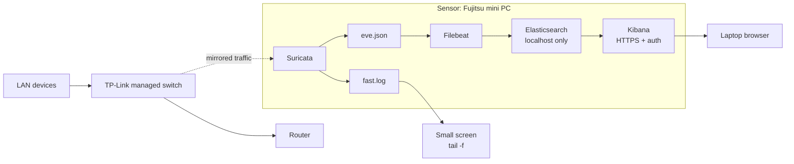

# Home IDS: Suricata + Filebeat + Elasticsearch + Kibana

A passive network IDS on a repurposed mini PC. It watches my home LAN through port mirroring, Suricata detects suspicious traffic, and I analyze the alerts in Kibana.

This is my first homelab project (Homelab v1). I built it in about three weeks while studying networking and network security.

> **Only monitor networks you own or have permission to monitor.**
>
> I set this up almost a year ago. Some configuration details may be out of date or contain mistakes, so check them against your own setup before reusing them.


<!-- Ideas for more images (uncomment when the files exist in images/):


-->

## Overview

| | |
|---|---|
| **Hardware** | Fujitsu ESPRIMO Q556/2 mini PC, Intel Core i5-7500T, 8 GB RAM, 256 GB SSD, small screen |
| **OS** | Ubuntu (latest release at the time) |
| **Capture** | Port mirroring on a managed TP-Link switch connected to the router |
| **Detection** | Suricata with custom rules + Emerging Threats Open (50,000+ rules) |
| **Pipeline** | Filebeat, Elasticsearch, Kibana |
| **Coverage** | About 15 devices |
| **Access** | SSH from my laptop. Kibana over HTTPS with authentication. Elasticsearch on localhost only |
| **Log rotation** | 72 hours |

## How it works



1. The switch copies the traffic of the monitored ports to the sensor.
2. Suricata inspects it and writes alerts to `fast.log` (readable) and `eve.json` (structured).
3. Filebeat sends `eve.json` to Elasticsearch, and I analyze it in Kibana.
4. The small screen runs `tail -f /var/log/suricata/fast.log` for a live view.

## Design decisions

- **IDS, not IPS.** A bad rule in blocking mode could cut the whole LAN. With a noisy network and 50,000+ rules, I keep it detection-only.
- **Port mirroring.** The sensor is outside the data path. If it fails, the network keeps working.
- **Own rules first, then Emerging Threats.** I wrote my own rules (pings, SSH sessions, unusual traffic, Nmap scans) to learn the syntax, then imported Emerging Threats for real coverage.
- **Disabled categories.** SCADA/ICS, VoIP, legacy protocols, old exploits and overly generic encrypted-traffic detections. They do not apply to a home LAN and only added noise.
- **Filebeat instead of Logstash.** Logstash was too heavy for 8 GB of RAM. Filebeat is lighter and its Suricata module already parses `eve.json`.
- **Authentication and TLS.** The alerts describe every device on the network, and I open Kibana from another machine.
- **Elasticsearch on localhost.** Only Filebeat and Kibana use it, both on the same machine. This avoids needing a proxy.
- **Two views.** `fast.log` on the screen for a quick look, Kibana for deeper analysis.

## False positives

Even after disabling those categories, many alerts were false positives. The LAN is busy and another homelab on it uses VPNs, so tunnel traffic kept matching rules. That is the main cost of a signature-based IDS on a network like this.

Example from my `fast.log` (2025-11-27): several `ET MALWARE ... Conficker-C P2P` alerts (SIDs 2009205 to 2009208) from a LAN host to `224.0.0.251:5353` (mDNS) and `239.255.255.250:1900` (SSDP). Those destinations are local multicast groups, so I read them as false positives.

## Setup

Replace the placeholders in `< >`:

| Placeholder | Meaning |
|---|---|
| `<MONITOR_IFACE>` | Capture interface of the sensor |
| `<SENSOR_LAN_IP>` | LAN address of the sensor |
| `<FILEBEAT_USER>` | Elasticsearch user for Filebeat |

Secrets and certificates are not included. Keep passwords and tokens in the keystores, not in the YAML files.

### 1. Port mirroring

On the TP-Link managed switch, enable port mirroring in its web interface (the menu name varies by model).

- **Mirrored ports:** the ones to monitor.
- **Mirroring port:** the one connected to the sensor's capture interface.

Check that the sensor sees the traffic:

```bash
sudo tcpdump -ni <MONITOR_IFACE> -c 20
```

### 2. Suricata

```bash
sudo add-apt-repository ppa:oisf/suricata-stable
sudo apt update && sudo apt install suricata
```

Merge this excerpt into `/etc/suricata/suricata.yaml`:

<details>
<summary><code>suricata.yaml</code> (relevant parts)</summary>

```yaml
vars:
  address-groups:
    HOME_NET: "[192.168.1.0/24]"
    EXTERNAL_NET: "!$HOME_NET"

# Capture from the NIC that receives the mirrored traffic.
af-packet:
  - interface: <MONITOR_IFACE>
    cluster-id: 99
    cluster-type: cluster_flow
    defrag: yes

outputs:
  # One line per alert. Shown on the sensor's screen.
  - fast:
      enabled: yes
      filename: fast.log
      append: yes
  # Structured events. Filebeat reads this file.
  - eve-log:
      enabled: yes
      filetype: regular
      filename: eve.json
      types:
        - alert
        - dns
        - http
        - tls
        - ssh
        - flow

# Emerging Threats (managed by suricata-update) plus my own rules.
default-rule-path: /var/lib/suricata/rules
rule-files:
  - suricata.rules
  - /etc/suricata/rules/local.rules
```

</details>

<!-- CHECK: compare this excerpt with the real /etc/suricata/suricata.yaml (HOME_NET, interface, cluster-id). -->

Create `/etc/suricata/rules/local.rules`. SIDs in the 1000000+ range are reserved for local use.

<details>
<summary><code>local.rules</code></summary>

```
# --- ICMP ---------------------------------------------------------------
alert icmp any any -> $HOME_NET any (msg:"LOCAL ICMP echo request to LAN"; itype:8; classtype:misc-activity; sid:1000001; rev:1;)

# --- SSH ----------------------------------------------------------------
alert tcp any any -> $HOME_NET 22 (msg:"LOCAL SSH connection attempt"; flow:to_server; flags:S,12; classtype:misc-activity; sid:1000002; rev:1;)
alert ssh any any -> $HOME_NET any (msg:"LOCAL SSH session detected"; flow:established,to_server; classtype:misc-activity; sid:1000003; rev:1;)

# --- Scans --------------------------------------------------------------
# Many SYN packets from one source in a short window: typical of nmap -sS.
alert tcp any any -> $HOME_NET any (msg:"LOCAL possible TCP SYN scan"; flags:S,12; threshold:type threshold, track by_src, count 30, seconds 10; classtype:attempted-recon; sid:1000010; rev:1;)
# Default user-agent of the Nmap Scripting Engine.
alert http any any -> $HOME_NET any (msg:"LOCAL Nmap Scripting Engine user-agent"; flow:established,to_server; http.user_agent; content:"Nmap Scripting Engine"; classtype:web-application-attack; sid:1000011; rev:1;)

# --- Unusual traffic ----------------------------------------------------
# Cleartext remote access leaving the LAN.
alert tcp $HOME_NET any -> $EXTERNAL_NET 23 (msg:"LOCAL outbound Telnet"; flow:to_server; flags:S,12; classtype:policy-violation; sid:1000020; rev:1;)
```

</details>

<!-- CHECK: replace with the rules actually deployed on the sensor. -->

Create `/etc/suricata/disable.conf`, which `suricata-update` reads to skip rule groups:

<details>
<summary><code>disable.conf</code></summary>

```
# Disabled to cut noise on a home LAN.

# SCADA / ICS
group:emerging-scada.rules

# VoIP
group:emerging-voip.rules

# Syntax: group:emerging-<name>.rules   or a SID   or re:<regex>
```

</details>

<!-- CHECK: add the groups/SIDs disabled for legacy protocols, old exploits and generic encrypted-traffic detections. -->

Download Emerging Threats Open, validate and start:

```bash
sudo suricata-update
sudo suricata -T -c /etc/suricata/suricata.yaml -v
sudo systemctl enable --now suricata
```

After editing `disable.conf`: `sudo suricata-update && sudo systemctl restart suricata`.

### 3. Elasticsearch, Kibana and Filebeat

```bash
wget -qO - https://artifacts.elastic.co/GPG-KEY-elasticsearch | sudo gpg --dearmor -o /usr/share/keyrings/elastic.gpg
echo "deb [signed-by=/usr/share/keyrings/elastic.gpg] https://artifacts.elastic.co/packages/8.x/apt stable main" | sudo tee /etc/apt/sources.list.d/elastic-8.x.list
sudo apt update && sudo apt install elasticsearch kibana filebeat
```

Elasticsearch 8 enables security and TLS on install and prints the `elastic` password once, so save it.

<details>
<summary><code>/etc/elasticsearch/elasticsearch.yml</code> (relevant lines)</summary>

```yaml
cluster.name: home-ids
discovery.type: single-node

# Localhost only: Filebeat and Kibana run on the same machine, so no proxy is needed.
network.host: 127.0.0.1

# Authentication and TLS (generated by Elasticsearch 8 on install)
xpack.security.enabled: true
xpack.security.http.ssl:
  enabled: true
  keystore.path: certs/http.p12
xpack.security.transport.ssl:
  enabled: true
  verification_mode: certificate
  keystore.path: certs/transport.p12
  truststore.path: certs/transport.p12
```

</details>

<details>
<summary><code>/etc/kibana/kibana.yml</code> (relevant lines)</summary>

```yaml
# Listens on the LAN address so I can open it from my laptop.
server.host: "<SENSOR_LAN_IP>"
server.port: 5601

# HTTPS for the browser
server.ssl.enabled: true
server.ssl.certificate: /etc/kibana/certs/kibana.crt
server.ssl.key: /etc/kibana/certs/kibana.key

# Elasticsearch (localhost)
elasticsearch.hosts: ["https://127.0.0.1:9200"]
elasticsearch.ssl.certificateAuthorities: ["/etc/kibana/certs/http_ca.crt"]
# The service token goes in the Kibana keystore, not in this file.
```

</details>

<details>
<summary><code>/etc/filebeat/filebeat.yml</code></summary>

```yaml
filebeat.config.modules:
  path: ${path.config}/modules.d/*.yml

# Used by "filebeat setup" to load the dashboards.
setup.kibana:
  host: "https://<SENSOR_LAN_IP>:5601"
  ssl.certificate_authorities: ["/etc/filebeat/certs/http_ca.crt"]

# Straight to Elasticsearch, no Logstash.
output.elasticsearch:
  hosts: ["https://127.0.0.1:9200"]
  username: "<FILEBEAT_USER>"
  password: "${ES_PASSWORD}"      # from the Filebeat keystore
  ssl.certificate_authorities: ["/etc/filebeat/certs/http_ca.crt"]
```

</details>

<details>
<summary><code>/etc/filebeat/modules.d/suricata.yml</code></summary>

```yaml
- module: suricata
  eve:
    enabled: true
    var.paths: ["/var/log/suricata/eve.json"]
```

</details>

<!-- CHECK: compare the Elasticsearch, Kibana and Filebeat blocks with the real files. -->

Start everything:

```bash
sudo systemctl enable --now elasticsearch kibana
sudo filebeat modules enable suricata
sudo filebeat test config
sudo filebeat setup --pipelines --modules suricata
sudo filebeat setup --dashboards
sudo systemctl enable --now filebeat
```

### 4. Test

From another machine, against devices you own:

```bash
ping <TARGET_IP>
nmap -sS -p 1-1000 <TARGET_IP>
```

The ping should trigger SID 1000001 and the scan SID 1000010. Watch the alerts live:

```bash
sudo tail -f /var/log/suricata/fast.log
```

They show up in Kibana a few seconds later.

### 5. Log rotation

Rotation is set to 72 hours.

<!-- TODO: add the config used and what it rotates (Suricata logs with logrotate, Elasticsearch indices, or both). -->

## Next steps

- Move from IDS to IPS. For now I keep it as IDS to avoid breaking the network by accident.
- Upgrade the RAM and storage of the mini PC and build more advanced projects on it.

## License

MIT
