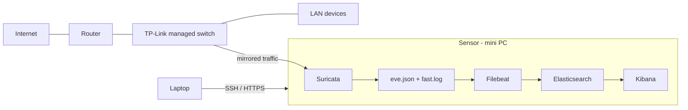

# Home IDS: Suricata + Filebeat + Elasticsearch + Kibana

A passive network IDS on a repurposed mini PC. It watches my home LAN through port mirroring, detects suspicious traffic with Suricata, and I analyze the alerts in Kibana.

This is my first homelab project (Homelab v1). I built it in about three weeks while studying networking and network security.

> Only monitor networks you own or have permission to monitor.

## Overview

| | |
|---|---|
| Hardware | Fujitsu ESPRIMO Q556/2 mini PC, Intel Core i5-7500T, 8 GB RAM, 256 GB SSD, small screen |
| OS | Ubuntu (latest release at the time) |
| Capture | Port mirroring on a managed TP-Link switch connected to the router |
| Detection | Suricata with custom rules + Emerging Threats Open (50,000+ rules) |
| Pipeline | Filebeat, Elasticsearch, Kibana |
| Coverage | About 15 devices |
| Access | SSH from my laptop. Kibana over HTTPS with authentication. Elasticsearch on localhost only |
| Log rotation | 72 hours |

## How it works



1. The switch copies the traffic of the monitored ports to the sensor.
2. Suricata inspects it and writes alerts to `fast.log` (readable) and `eve.json` (structured).
3. Filebeat sends `eve.json` to Elasticsearch, and I analyze it in Kibana.
4. The small screen runs `tail -f /var/log/suricata/fast.log` for a live view.


## Why I made these choices

- **IDS, not IPS.** A bad rule in blocking mode could cut the whole LAN. With a noisy network and 50,000+ rules, I keep it detection-only.
- **Port mirroring.** The sensor is outside the data path. If it fails, the network keeps working.
- **Own rules first, then Emerging Threats.** I wrote my own rules (pings, SSH sessions, unusual traffic, Nmap scans) to learn the syntax, then imported Emerging Threats for real coverage.
- **Disabled categories.** SCADA/ICS, VoIP, legacy protocols, old exploits and overly generic encrypted-traffic detections. They do not apply to a home LAN and only added noise.
- **Filebeat instead of Logstash.** Logstash was too heavy for 8 GB of RAM. Filebeat is lighter and its Suricata module already parses `eve.json`.
- **Authentication and TLS.** The alerts describe every device on the network, and I open Kibana from another machine.
- **Elasticsearch on localhost.** Only Filebeat and Kibana use it, both on the same machine. This avoids needing a proxy.
- **Two views.** `fast.log` on the screen for a quick look, Kibana for deeper analysis.

## False positives

Even after disabling those categories, many alerts were false positives. The LAN is busy and another homelab on it uses VPNs, so tunnel traffic kept matching rules. That is the main cost of a signature-based IDS on a network like this.

Example from my `fast.log` (2025-11-27): several `ET MALWARE ... Conficker-C P2P` alerts (SIDs 2009205 to 2009208) from a LAN host to `224.0.0.251:5353` (mDNS) and `239.255.255.250:1900` (SSDP). Those destinations are local multicast groups, so I read them as false positives...

## Files

```
configs/
  suricata/        suricata-excerpt.yaml, local.rules, disable.conf
  filebeat/        filebeat.yml, modules.d/suricata.yml
  elasticsearch/   elasticsearch.yml
  kibana/          kibana.yml
docs/setup.md
```

Secrets and certificates are not in the repo. Placeholders look like `<THIS>`.

## Next steps

- Move from IDS to IPS. For now I keep it as IDS to avoid breaking the network by accident.
- Upgrade the RAM and storage of the mini PC and build more advanced projects on it.

## License

MIT
